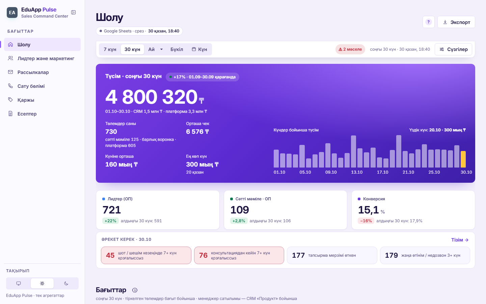

# EduApp Pulse — Sales & Leads Analytics Dashboard

A sales command center for an online-education company. It turns an amoCRM deals export, a payments platform and a few Google Sheets (costs, mailings, KPI targets, product catalog) into privacy-safe aggregate cubes. Those cubes feed a single-file dashboard (`Атлас_отчёты.html`) and shareable daily report cards (`card.html`).



## Features

- **Google Apps Script API** (`инструменты/EduApp_OP_API.gs`):
  - Reads CRM, payments and service sheets and returns **only aggregates**: counts and sums by day, funnel, stage, source, offer, product and manager.
  - Never returns names, phones, receipts or deal titles.
  - Masks small cells (< 3 children) on the server.
  - A 10-minute trigger refreshes the cache and stores daily snapshots.
- **Dashboard (Atlas):** one HTML file with no build step and no framework.
  - **Sections:**
    - Overview: revenue hero, KPI tiles and an "action needed" list.
    - Leads & marketing: channels, UTM creatives, audience by region and grade.
    - WhatsApp mailing waves: reply rates, ROI and timing.
    - Sales team: manager leaderboard and data-fill quality.
    - Finance: revenue, costs, tariffs and plan vs fact.
    - Reports.
  - **Filters:** source, offer, product, manager and tag. Comparison with the previous period is offered only when it is valid.
  - **Exports:** PDF via jsPDF + svg2pdf, CSV, WhatsApp-ready text, and a "frozen snapshot" HTML file.
  - **Other:**
    - Light and dark themes.
    - A PIN curtain.
    - Shareable URL state that never contains names (filter values are hashed).
- **Daily cards** (`card.html?card=leads|sales&d=YYYY-MM-DD`): mobile-first one-page reports built from the same client code as the Apps Script card.
- **Python parity tool** (`инструменты/обновить_данные.py`): the same CRM aggregation from an `.xlsx` export. A test checks it against the Apps Script implementation.
- **Deterministic build** (`инструменты/собрать.js`):
  1. Runs the tests.
  2. Generates the card.
  3. Checks JS syntax.
  4. Scans published files for phones, e-mails and tokens.
  5. Regenerates `docs/метрики.md` from the metric registry.
  6. Writes `vercel_deploy/` with a hash manifest.
- **Regression tests:** about 120 `node:test` cases covering the calculation layer, Apps Script functions and security rules.

## Tech stack

Vanilla JavaScript (ES2020), HTML/CSS, Google Apps Script (V8), Node.js 18+ (`node:test`, `vm`), Python 3.10+ (optional tool, needs `openpyxl`), jsPDF + svg2pdf.js (vendored, see `atlas_v4_assets/ЛИЦЕНЗИИ.txt`), Inter font (OFL), Vercel static hosting.

## Project structure

```
Атлас_отчёты.html              the dashboard: CSS + JS + embedded snapshots <script id="crm"> / <script id="sales">
card.html                      daily report card (generated from the Apps Script card client)
atlas_v4_assets/               fonts and PDF libraries used by the dashboard
инструменты/
  EduApp_OP_API.gs             Apps Script web app: aggregation (zopAggregate_, zopSalesAggregate_), cards, sheet tools
  обновить_данные.py           Python version of the CRM aggregation (from an amoCRM .xlsx export)
  собрать.js                   deterministic build → vercel_deploy/
  собрать_карточку.js          builds card.html from the Apps Script card client
scripts/generate-demo-data.cjs random raw sheets → real aggregation code → embedded demo snapshots + demo/*.json
demo/crm.json, demo/sales.json generated demo snapshots (used by card.html and by the tests)
tests/                         node:test regression tests (tests/lib/load.cjs loads the pure layers into a sandbox)
docs/метрики.md                metric dictionary (generated), docs/качество_данных.md — data-quality rules
vercel_deploy/vercel.json      routes /leads and /sales → card.html
```

## How to run (demo mode)

Demo mode is the default. `LIVE_URL` in `Атлас_отчёты.html` is empty, so the dashboard uses only the embedded, randomly generated snapshot and never calls Google.

```bash
python -m http.server 8790        # from the repository root (any static server works)
```

- Dashboard: http://127.0.0.1:8790/Атлас_отчёты.html. The demo PIN is **1234**. You can also open the file directly from disk.
- Daily cards: http://127.0.0.1:8790/card.html?card=sales and `?card=leads`. In demo mode they read `demo/*.json`.

```bash
node scripts/generate-demo-data.cjs [seed]   # regenerate the random demo data (default seed is reproducible)
node --test tests/*.test.cjs                 # regression tests
node инструменты/собрать.js                  # full build: tests → card → checks → vercel_deploy/
```

### Live mode

1. Paste `инструменты/EduApp_OP_API.gs` into an Apps Script project bound to your Google Sheet.
2. Set the sheet IDs (`YOUR_*_SHEET_ID`) and run `zopSetup` once.
3. Deploy it as a web app.
4. Put the `/exec` URL into `LIVE_URL` in `Атлас_отчёты.html` and rebuild.

The optional WhatsApp-inquiries summary (the `S7000` block) needs its own server URL and key. In the demo it shows "not connected".

### About the demo data

`scripts/generate-demo-data.cjs` generates raw rows that look like the real sources:

- an amoCRM deals export with funnels, stages, outcomes, managers, sources, offers, products, regions and grades;
- WhatsApp mailing waves with import tags and reply/conversion behaviour;
- support tickets;
- platform payments with invoice statuses;
- costs, tariffs, KPI targets and hypotheses.

The data follows weekday seasonality, an autumn trend and realistic funnel ratios. The script then runs these rows through the **actual** Apps Script aggregation functions, so the embedded snapshot has exactly the shape the live API returns.

> All data in this repository is randomly generated; brand names are anonymized.

**Note on tests:** 16 of the 122 tests asserted exact values or legacy formats of the original private snapshot. They are marked `skip` with that reason. The other 106 run against the generated demo data.

## Кратко (RU)

EduApp Pulse — аналитика для отдела продаж онлайн-образования: дашборд и ежедневные карточки отчётов по лидам, рассылкам, менеджерам, выручке и расходам на основе amoCRM, платёжной платформы и Google-таблиц.
Apps Script отдаёт только агрегаты (без ФИО и телефонов), дашборд — один HTML-файл с экспортом в PDF/CSV/WhatsApp.
Демо: `python -m http.server 8790` → `Атлас_отчёты.html` (PIN 1234); пересоздать данные — `node scripts/generate-demo-data.cjs`.
Все данные сгенерированы случайно, названия брендов изменены.
